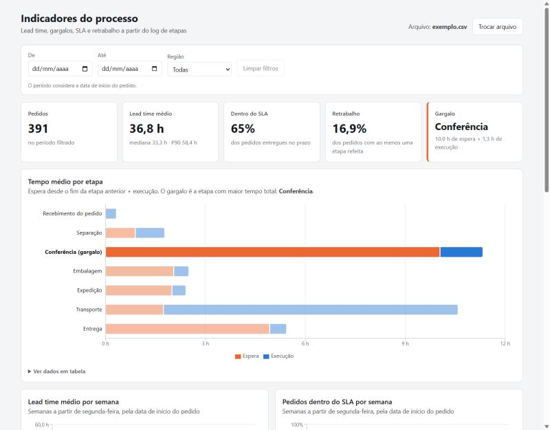

# Dashboard de KPIs de processos

Muita empresa tem o log do processo numa planilha (quando cada pedido entrou e saiu de cada etapa), mas não consegue responder perguntas simples a partir dele: quanto tempo um pedido leva de ponta a ponta, onde ele fica parado, quantos saem do prazo e quanto se refaz.

Montei este dashboard para responder essas perguntas sem precisar de BI nem de backend. Você sobe um CSV ou XLSX com uma linha por etapa executada, e a tela calcula lead time, gargalo, SLA e retrabalho, com filtro por período e região. Tudo roda no navegador e o arquivo não sai da máquina de quem usa.

Os dados de exemplo são de um processo logístico fictício (recebimento → separação → conferência → embalagem → expedição → transporte → entrega). Coloquei um gargalo de propósito: só existe um conferente, e em outubro o volume e a reprovação na conferência aumentam. No dashboard dá para ver a fila crescer e o SLA cair de 83% para 50%.

**Demo:** https://dashboard-kpis-processos.vercel.app (clique em "Usar dados de exemplo")



## Como rodar

Precisa de Node 22 ou mais novo.

```bash
npm install
npm run dev
```

Outros comandos:

```bash
npm test             # testes do parser e dos cálculos
npm run build        # build de produção em dist/
npm run gerar-dados  # recria public/exemplo.csv e public/exemplo.xlsx
```

O gerador usa seed fixa, então sempre produz os mesmos arquivos.

## Formato do arquivo

Uma linha por etapa executada. Se a etapa foi refeita, ela aparece de novo com `retrabalho = S`.

| coluna        | exemplo            | observação                                        |
|---------------|--------------------|---------------------------------------------------|
| `pedido_id`   | `PED-10001`        |                                                   |
| `etapa`       | `Conferência`      |                                                   |
| `inicio`      | `2026-09-01 08:30` | também aceita `01/09/2026 08:30` e data do Excel  |
| `fim`         | `2026-09-01 09:10` | não pode ser antes do início                      |
| `responsavel` | `CONF-01`          |                                                   |
| `regiao`      | `Capital SP`       |                                                   |
| `retrabalho`  | `S` ou `N`         |                                                   |
| `sla_horas`   | `24`               | SLA do pedido, em horas                           |

- Os nomes das colunas são comparados sem diferenciar maiúsculas, acentos e espaços (`Início`, `INICIO` e `inicio` funcionam).
- A ordem das colunas não importa, e o separador pode ser vírgula ou ponto e vírgula.
- Se faltar alguma coluna, o erro diz qual é.
- Linhas inválidas (data ilegível, fim antes do início, SLA não numérico etc.) são ignoradas, e a tela mostra quantas foram.
- O limite é de 10 MB por arquivo.

## Como cada KPI é calculado

Os cálculos estão em `src/lib/kpis.ts`, como funções puras e com testes.

- **Lead time do pedido:** fim da última etapa menos o início da primeira. Mostro média, mediana e P90. O P90 usa a mesma interpolação do `PERCENTIL.INC` do Excel, para bater com quem for conferir na planilha.
- **SLA:** o pedido está no prazo quando o lead time é menor ou igual ao `sla_horas`. O indicador é o percentual de pedidos no prazo.
- **Execução da etapa:** fim menos início de cada linha, em média por etapa (as repetições por retrabalho entram na conta).
- **Espera da etapa:** início da etapa menos o fim da etapa anterior do mesmo pedido. A primeira etapa não tem espera, e sobreposição conta como zero.
- **Gargalo:** a etapa com o maior tempo médio total (espera + execução).
- **Retrabalho:** percentual de pedidos com pelo menos uma linha marcada como `S`, no geral e por etapa.
- **Tendência semanal:** pedidos agrupados pela semana (de segunda a domingo) em que começaram. Lead time e SLA ficam em gráficos separados, porque têm escalas diferentes.
- **Mais atrasados:** os 10 pedidos com maior diferença entre lead time e SLA.
- **Filtros:** o período usa a data de início do pedido. Todos os indicadores são recalculados com os pedidos filtrados.

## Estrutura

```
scripts/gerar-dados.ts   gera os dados fictícios
src/lib/parse.ts         leitura de CSV/XLSX e validação
src/lib/kpis.ts          cálculos
src/components/          tela e gráficos
```

Stack: React, TypeScript, Vite, Papa Parse, SheetJS (instalado pelo CDN oficial, porque o pacote `xlsx` do npm está parado numa versão com vulnerabilidade conhecida), Recharts e Vitest.

## Próximas melhorias

- Permitir mapear colunas com nomes diferentes direto na tela, sem editar o arquivo
- Filtro por responsável e ranking de produtividade por código
- Comparar dois períodos lado a lado (por exemplo, setembro × outubro)
- Exportar os indicadores filtrados em CSV ou PDF
- Calcular o tempo só em horário útil, considerando o turno de cada etapa
- Processar arquivos grandes num Web Worker, para não travar a tela
